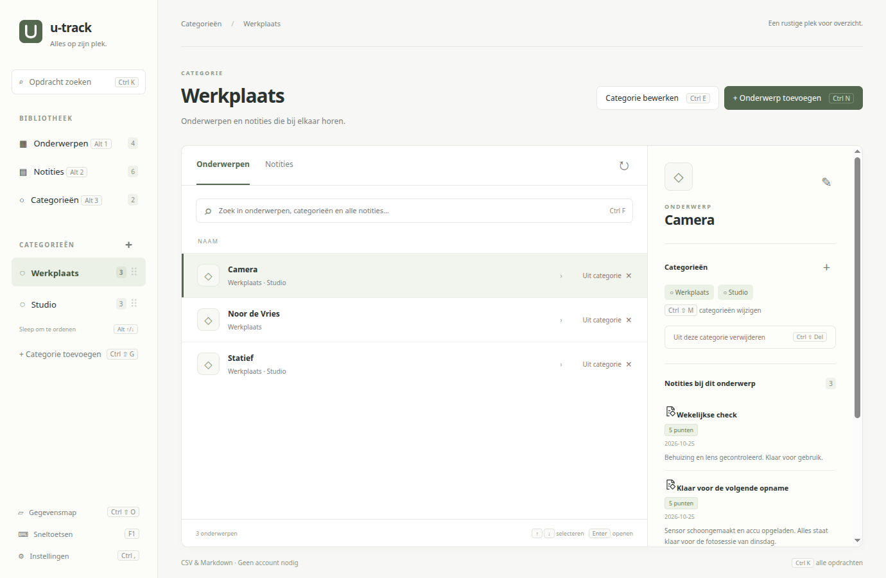
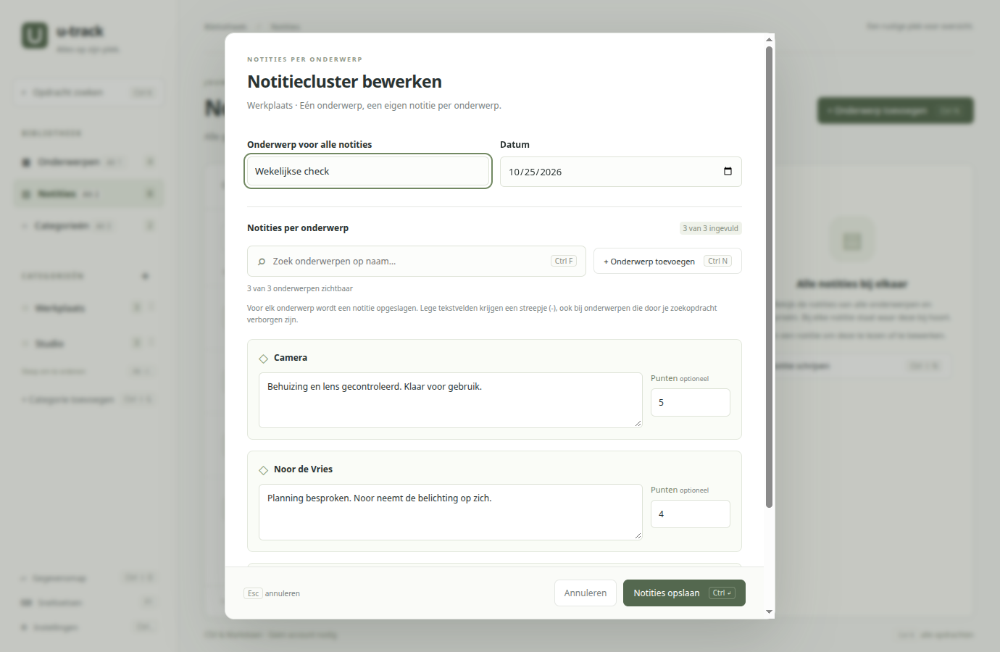
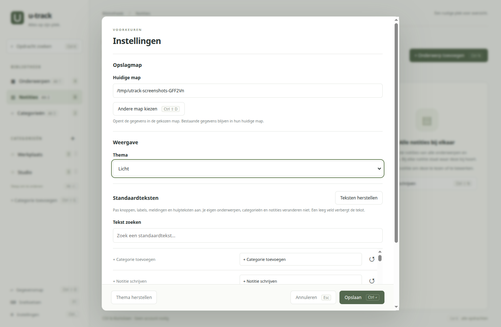

# u-track

Onderwerpen, categorieën en notities op één plek. Lokaal op je eigen computer, zonder account.

**[Download u-track voor Ubuntu / Debian](u-track_1.0.0_amd64.deb)** · Versie 1.0.0 · Linux amd64 · circa 118 MB

Of open de [downloadpagina](index.html) voor een overzicht en installatie-uitleg.

## Installeren

1. Download het `.deb`-bestand.
2. Open het met je pakketinstallatieprogramma en kies **Installeren**.
3. Start **u-track** via het applicatiemenu.

Liever via de terminal? Voer dit uit in de map met het gedownloade bestand:

```sh
sudo apt install ./u-track_1.0.0_amd64.deb
```

Electron is inbegrepen; Node.js en npm zijn niet nodig. Dit pakket is voor Ubuntu/Debian op een 64-bits Intel/AMD-computer, niet voor Windows, macOS of ARM.

## In beeld

### Je onderwerpen en notities bij elkaar

Voeg personen of spullen toe aan meerdere categorieën. Zoek door namen en notities en werk met de muis of sneltoetsen.



### Notities samen bijwerken

Schrijf notities voor alle onderwerpen in een categorie en werk ze als cluster bij, met optionele punten. Elke notitie blijft een afzonderlijk Markdown-bestand.



### Instellen zoals jij wilt

Kies een opslagmap, een licht of donker thema, eigen kleuren en aangepaste standaardteksten.



*Screenshots van de huidige app met voorbeeldgegevens.*

Je gegevens staan standaard in `Documenten/u-track`, als CSV en Markdown. De app is nog in ontwikkeling: maak een back-up voordat je een nieuwe versie installeert.

[Gebruikershandleiding](Handleiding.md) · [Broncode en ontwikkeling](code/README.md)
